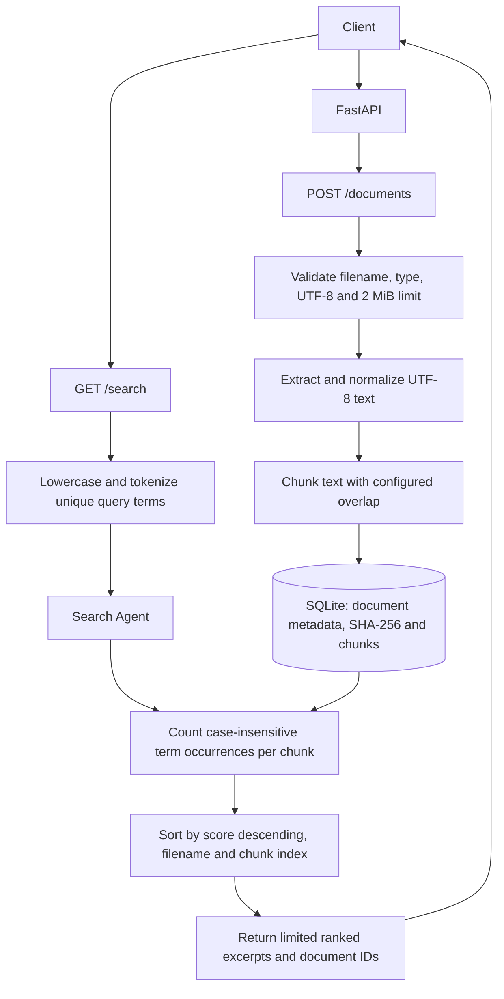

# Enterprise Knowledge Platform — Current Architecture

The diagram below reflects the implemented local-first ingestion and keyword-retrieval path in this release. It does not depict planned cloud, vector-search, or LLM integrations.

## Implemented components

- FastAPI upload, metadata retrieval, health, and search endpoints
- Filename/type validation, UTF-8 decoding, normalization, and upload-size enforcement
- Overlapping text chunking
- SQLite persistence for document metadata, SHA-256 digests, and chunks
- Deterministic keyword occurrence scoring and bounded result ranking

## Retrieval semantics

Query text is lowercased and tokenized into unique alphanumeric terms of at least two characters. Each chunk receives a score equal to the total number of occurrences of those terms, counted case-insensitively. Matching chunks are ordered by descending score, then filename and chunk index, before the result limit is applied. This is lexical keyword matching; it is not semantic search or embedding-based retrieval.

## Not implemented in this release

PDF/DOCX extraction, embeddings, vector databases, Amazon S3, Amazon Bedrock, LLM answer generation, knowledge-graph construction, recommendations, authentication, and per-user authorization.
