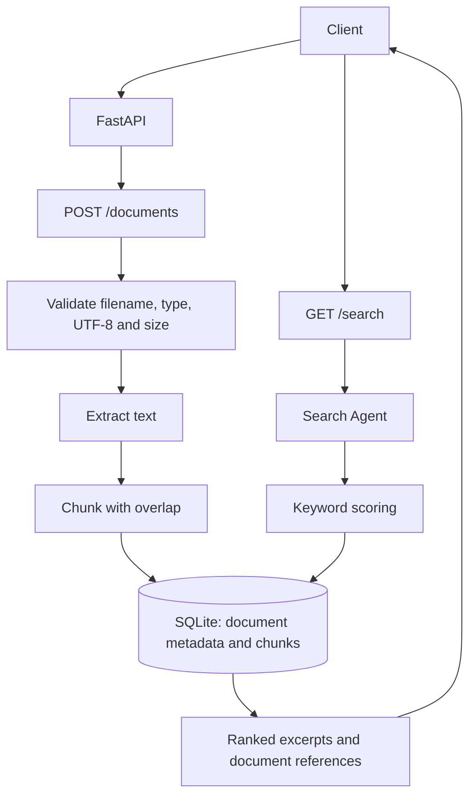

# Enterprise Knowledge Platform — Current Architecture

The diagram below reflects the implemented local-first ingestion and keyword-retrieval path in this release. It does not depict planned cloud, vector-search, or LLM integrations.

## Implemented components

- FastAPI upload and search endpoints
- Document validation and UTF-8 text extraction
- Overlapping text chunking
- SQLite persistence for metadata and chunks
- Deterministic keyword-based retrieval

## Not implemented in this release

PDF/DOCX extraction, embeddings, vector databases, Amazon S3, Amazon Bedrock, LLM answer generation, knowledge-graph construction, recommendations, authentication, and per-user authorization.
